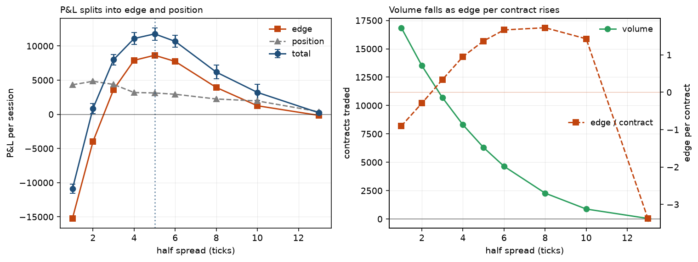
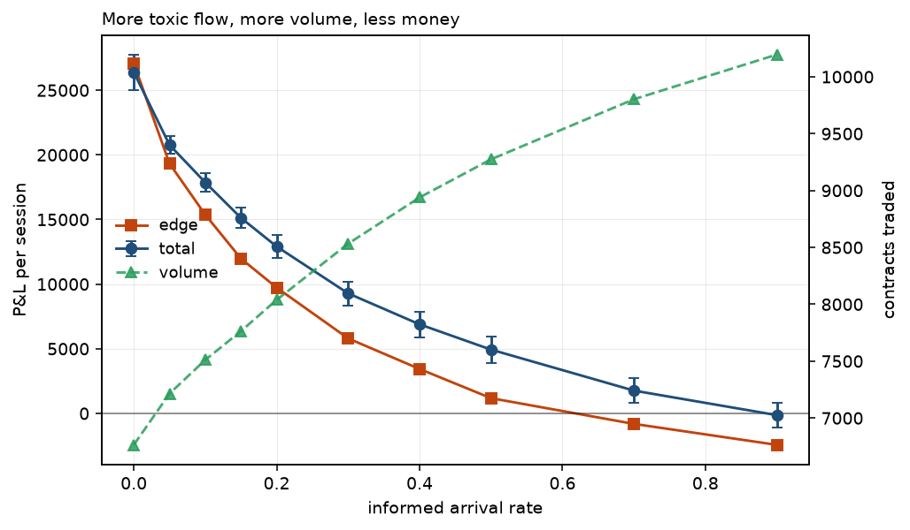
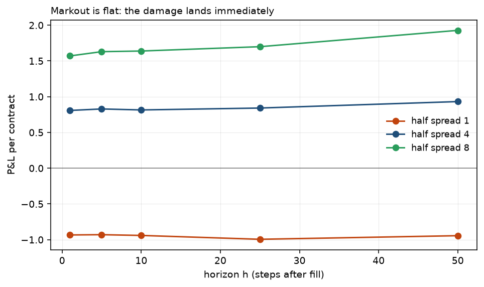
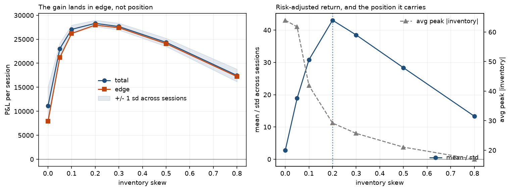

# A limit order book and a market maker that loses money

A matching engine, a naive market maker, and the order flow that trades against
it. I built this to find out what actually happens to a quoting strategy when
some of the people hitting it know more than it does, because I had read the
words "adverse selection" several times without having any feel for the size of
the effect.

The short version of what I found: the naive market maker loses money, the
losses are not where I expected them, and the cheapest fix turned out to work
for a different reason than the one I built it for.

```
pip install -r requirements.txt
python run_all.py          # tests, three experiments, figures. ~5 min single core.
```

---

## The model

One asset. Prices are integer ticks; the engine never sees a float.

There is a latent true value `V_t` that follows a random walk with occasional
jumps. Nobody posts it. **Informed traders** see it and only trade when the book
is wrong by more than a tick. Everybody else, including the market maker, sees
only the tape: an EWMA of printed trade prices, which is a decent estimate of
`V_t` right up until the moment it isn't.

That asymmetry is the whole engine of the thing. When the value jumps, the
maker's quote is stale for as long as it takes the tape to catch up, and during
that window it is offering a free option to anyone who can see the jump.

Four agents trade:

| Agent | Role |
|---|---|
| `MarketMaker` | Quotes both sides at `estimate ± half_spread`, skewed by inventory. The subject. |
| `BackgroundLiquidity` | Other makers quoting off the same tape, at random wider offsets. The competition. |
| `NoiseTrader` | Uninformed market orders. The flow you want. |
| `InformedTrader` | Sees `V_t`, takes when the book is mispriced. The flow you get anyway. |

The background liquidity providers exist for a specific reason. Without them, a
market maker quoting a 40-tick spread would still get filled by every noise
trader, and the model would conclude that wider is always better. With them, our
maker only trades when it has undercut the draw, so its fill rate falls as its
spread widens. That is what creates a real trade-off instead of a free lunch.

### The matching engine

Price-time priority. Each side is a dict of `price -> deque` of resting orders,
giving FIFO within a level in O(1) at both ends. Finding the best price by
scanning the dict would be O(levels), so each side also keeps a heap of prices —
min-heap for asks, max-heap for bids via negation. Heaps cannot delete an
arbitrary element, so emptied levels are cleared lazily: `_best` pops stale
prices off the top until it finds one with resting volume. Each price is pushed
at most once per time it becomes non-empty, so it stays O(log L) amortised.

Trades print at the **maker's** price, so the taker gets any price improvement.
That is what makes queue position worth something, and it is one of the things
`tests/test_book.py` pins down.

---

## The accounting

The headline P&L of a market maker tells you almost nothing on its own. A good
session and a bad session can print the same number for opposite reasons. So
every result splits it into two parts:

```
total = edge + position

edge     = Σ dqᵢ · (vᵢ − pᵢ)      what it charged over fair, at the moment of the fill
position = Σ dqᵢ · (V_T − vᵢ)     what the resulting inventory did afterwards
```

This is an identity, not an approximation — `tests/test_simulation.py` asserts
it holds to floating point on every seed. The derivation is three lines and is
in the `metrics.py` docstring.

**Edge** is the part the maker controls. It goes negative when the flow is
toxic. It is the number to watch.

**Position** is what happens to you while you are holding the bag. It has a mean
near zero over many sessions and a large variance. Early on I was reading total
P&L and drawing conclusions that were pure noise in this term.

All numbers below are means over 20 seeds of 8,000 steps.

---

## Experiment 1: how wide should the quote be?



| half spread | total P&L | edge | position | volume | edge / contract |
|---:|---:|---:|---:|---:|---:|
| 1 | −10,916 | −15,238 | 4,321 | 16,857 | −0.90 |
| 2 | 860 | −3,977 | 4,837 | 13,514 | −0.29 |
| 3 | 7,986 | 3,612 | 4,375 | 10,699 | 0.34 |
| 4 | 11,092 | 7,902 | 3,190 | 8,302 | 0.95 |
| **5** | **11,768** | 8,641 | 3,127 | 6,304 | 1.37 |
| 6 | 10,676 | 7,740 | 2,937 | 4,643 | 1.67 |
| 8 | 6,175 | 3,930 | 2,245 | 2,277 | 1.73 |
| 10 | 3,212 | 1,253 | 1,958 | 877 | 1.43 |
| 13 | 222 | −163 | 385 | 48 | −3.38 |

There is an interior optimum around 5 ticks, and both failure modes are visible
in the same table.

**Quoting at one tick loses 10,916 per session.** The maker wins the queue every
single time — including against every informed trader. It trades 16,857
contracts, more than any other setting, and every one of them is at a price it
should not have offered. Edge per contract is −0.90.

The thing I had not internalised before running this: *the tightest quote has
the highest volume and the worst P&L*. Volume is not a proxy for anything good.
It is the first column I would now discount.

**Quoting at 13 ticks earns 222.** Edge per contract looks fine right up to 10,
but the background makers are inside it almost always, so it trades 48 contracts
and the sample is too small to mean anything. Being right about price is
worthless if you are never at the front of the book.

Notice also that `edge` and `total` peak in the same place while `edge per
contract` keeps climbing to 8 ticks. Optimising per-contract profitability would
have picked the wrong spread. The quantity being maximised is edge × volume, and
the two move against each other.

---

## Experiment 2: what does informed flow cost?

Half spread fixed at 4, varying the arrival rate of traders who can see `V_t`.



| informed rate | total P&L | edge | volume | edge / contract |
|---:|---:|---:|---:|---:|
| 0.00 | 26,395 | 27,073 | 6,764 | 4.00 |
| 0.10 | 17,868 | 15,372 | 7,511 | 2.05 |
| 0.20 | 12,907 | 9,724 | 8,039 | 1.21 |
| 0.30 | 9,282 | 5,799 | 8,533 | 0.68 |
| 0.50 | 4,931 | 1,175 | 9,274 | 0.13 |
| 0.70 | 1,761 | −815 | 9,803 | −0.08 |
| 0.90 | −138 | −2,438 | 10,195 | −0.24 |

Against purely uninformed flow the maker captures 4.00 ticks per contract on a
4-tick half spread, which is roughly what the arithmetic says it should. Every
increment of informed flow takes a bite out of that, and somewhere around a 0.7
arrival rate no fixed 4-tick spread pays for the picking off any more.

The column worth staring at is **volume, which goes up the whole way down**.
6,764 contracts at the top, 10,195 at the bottom. As the flow gets more toxic
the maker trades *more*, because informed traders are precisely the ones who
always find a reason to cross. A desk watching fill rate as a health metric
would see this deteriorating book as a busy, healthy one.

### Markout

Average P&L per contract, `h` steps after each fill:



| half spread | h=1 | h=5 | h=10 | h=25 | h=50 |
|---:|---:|---:|---:|---:|---:|
| 1 | −0.93 | −0.93 | −0.94 | −0.99 | −0.94 |
| 4 | 0.81 | 0.83 | 0.82 | 0.84 | 0.93 |
| 8 | 1.57 | 1.63 | 1.64 | 1.70 | 1.93 |

These curves are **flat**, and that is a limitation of my model rather than a
finding. On a real desk a toxic-flow markout starts near zero and decays as the
information gets incorporated. Here it is negative at `h=1` and stays there,
because my informed traders see the *contemporaneous* value rather than a future
one. The quote is already wrong when it is hit, so all the damage lands
immediately and there is nothing left to leak out. Giving informed traders a
noisy forecast of `V_{t+k}` instead would produce the decaying shape, and is the
first thing I would change.

---

## Experiment 3: what does inventory skew buy?

Skewing means shifting both quotes against your position: when long, quote lower
on both sides so you are keener to sell than to buy. I built it expecting to pay
for lower variance out of mean P&L.



| skew | total P&L | std across sessions | mean / std | edge | avg peak abs inventory |
|---:|---:|---:|---:|---:|---:|
| 0.00 | 11,092 | 3,983 | 2.8 | 7,902 | 64 |
| 0.05 | 23,033 | 1,220 | 18.9 | 21,204 | 62 |
| 0.10 | 27,059 | 879 | 30.8 | 26,210 | 42 |
| **0.20** | **28,316** | **658** | **43.1** | 27,961 | 29 |
| 0.30 | 27,655 | 718 | 38.5 | 27,410 | 26 |
| 0.50 | 24,361 | 859 | 28.4 | 24,083 | 21 |
| 0.80 | 17,470 | 1,310 | 13.3 | 17,230 | 17 |

This is the result I got wrong. Variance falls as expected — standard deviation
across sessions drops sixfold and peak position halves. But **mean P&L more than
doubles**, from 11,092 to 28,316, and the gain is almost entirely in `edge`
(7,902 → 27,961), which is the adverse selection term, not the inventory term.

The mechanism, once I went looking for it: in this model inventory is not just
risk, it is *evidence*. The way the maker ends up long is by having its stale bid
hit repeatedly after the value jumped down. So a large position is a signal that
the value has moved against it and the tape has not caught up yet. Skewing
quotes away from the accumulating side is therefore a crude, free estimator of
"my fair value is wrong, in this direction" — and it stops the bleeding faster
than the EWMA does.

I did not design it to do that. It fell out of the numbers, and I only believed
it after checking that the improvement lived in `edge` rather than `position`.
That decomposition is the reason I could tell the difference at all.

Past 0.3 it reverses: the quotes get pushed so far from fair that the maker
stops competing for flow, and it degrades into the wide-spread failure from
experiment 1.

---

## Layout

```
lob/book.py        matching engine, price-time priority, lazy heap deletion
lob/market.py      value process, simulation loop, per-agent ledger
lob/agents.py      market maker, background liquidity, noise and informed takers
lob/metrics.py     total = edge + position, markout, cross-seed summaries
experiments/       the three studies above, plus plotting
tests/             38 tests: engine invariants and the P&L identity
```

`python -m pytest tests -q` runs in about 8 seconds. `run_all.py` refuses to run
the experiments if they fail, because a conclusion drawn from a broken matching
engine is worse than no conclusion.
